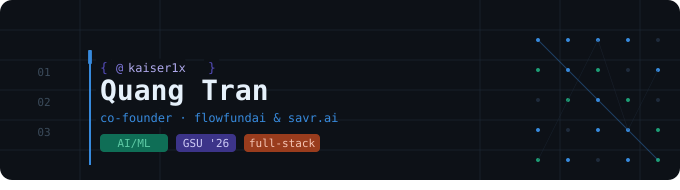

 <div align="center">



# Quang Tran

**Founder · Software Engineer · Product Builder**

Building **Galleriverse** — Draw a room. Hang your work. Open the doors.

Computer Science @ Georgia State University · Class of 2026

[Email](mailto:qdtran.dev@gmail.com) · [GitHub](https://github.com/kaiser1x) · [LinkedIn](https://www.linkedin.com/in/quang-tran-dev/)

</div>

---

## Building

### Galleriverse

**Creative Tools · 3D · Digital Art**

Galleriverse is my current startup and primary focus, a no-code 3D gallery builder that lets anyone turn a simple floor plan into an immersive, walkable art exhibition.

Draw rooms on a 2D grid, customize their atmosphere, hang artwork, add sculptures and soundtracks, then publish a gallery anyone can explore through a link. No 3D modeling skills or visitor accounts required.

I'm building Galleriverse from the ground up across product design, interactive 3D rendering, editor architecture, infrastructure, and user experience.

**What I'm focused on:**
- **Intuitive creation:** A floor-plan editor with grid snapping, room connections, drag-to-resize, and full undo/redo.
- **Immersive experiences:** Walkable 3D spaces with dynamic lighting, room-specific atmospheres, spatial transitions, and cross-fading soundtracks.
- **Art-first presentation:** Artwork plaques, picture lighting, customizable interiors, and support for images, video, GIFs, and 3D objects.
- **Instant publishing:** Shareable public galleries with private edit links, automatic saving, and no account required for visitors.
- **Reliable architecture:** A framework-independent scene compiler that transforms a simple 2D gallery document into a complete 3D environment.

**Tech stack:** Next.js · TypeScript · React Three Fiber · three.js · Tailwind CSS · Zustand · Zod · Howler · Vercel · Vultr Object Storage


Currently focused on:

```text
Product        Designing the core experience
Engineering    Building the platform and infrastructure
AI             Intelligent and personalized experiences
Team           Building and leading the engineering team
Scale          Designing for real users from day one
```

> **Build the product. Build the team. Build the company.**

---

## Previously Built

A selection of products I've designed, developed, and deployed.
[View all projects →](https://www.linkedin.com/in/quang-tran-dev/details/projects/)

### FlowFund AI

**AI-powered financial intelligence platform**

A financial platform designed to help users understand their spending and make smarter investment decisions.

`React` `Node.js` `Python` `MySQL` `AI`

---

### savr.ai

**AI-powered meal planning assistant**

An AI application that analyzes grocery receipts and generates personalized meal planning and food insights.

`React` `Node.js` `AWS Lambda` `Bedrock` `Textract` `DynamoDB` `S3`

---

### VibzCheck

**Collaborative music discovery platform**

A mobile application built around discovering, sharing, and interacting with music.

`Flutter` `Dart` `Firebase` `Spotify API`

---

### Sentinel

**Intelligent security & monitoring platform**

A security-focused application designed to detect, monitor, and surface important events through automated analysis and intelligent alerting.

`React` `Node.js` `Python` `AI`

[View project →](https://www.linkedin.com/posts/quang-tran-dev_hacklanta-hackathon-computervision-activity-7444857446935801857-SRP4?utm_source=share&utm_medium=member_desktop&rcm=ACoAAEbf9fIBqmbItGf6p9WjlRa73NBNACsvlLM)

---

## Engineering

I enjoy working across the entire product lifecycle rather than staying within one layer of the stack.

```text
Product
    ↓
Architecture
    ↓
Frontend + Backend
    ↓
AI / Data
    ↓
Infrastructure
    ↓
Deployment
    ↓
Users
```

### AI Systems

LLM applications, agentic architectures, RAG, and AI-first product design.

### Product Engineering

Building clean interfaces backed by reliable, production-ready systems.

### Infrastructure

Cloud architecture, APIs, databases, authentication, deployment, and scalability.

### Startups

Turning ideas into products, building engineering teams, and learning through shipping.

---

## Stack

```text
Languages
TypeScript · JavaScript · Python · Java · C

Frontend
React · React Native · Next.js

Backend
Node.js · Express · Python · REST APIs

Data
PostgreSQL · MySQL · MongoDB · DynamoDB

AI
OpenAI · AWS Bedrock · LLMs · RAG · AI Agents

Cloud
AWS · Docker · Supabase · Vercel · Railway
```

---

## Currently

```text
01  Building Mob
02  Leading engineering & product
03  Exploring AI-native social experiences
04  Building and deploying production systems
05  Finishing my Computer Science degree at GSU
```

---

## Let's Build

I'm interested in ambitious products, early-stage startups, AI, and engineering problems worth solving.

**If you're building something interesting, I'd love to hear about it.**

[qdtran.dev@gmail.com](mailto:qdtran.dev@gmail.com)

---

<div align="center">

[LinkedIn](https://www.linkedin.com/in/quang-tran-dev/) 

</div>

